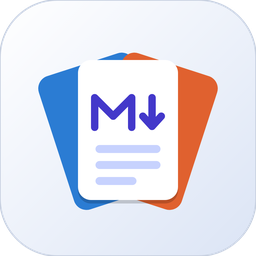

<div align="center">
  <picture>
    <source media="(prefers-color-scheme: dark)" srcset="public/icones/mdoffice-escuro.png">
    
  </picture>

  <sub>MDOFFICE</sub>

# mdOffice

**Suíte de documentos em português: Markdown, documentos, planilhas e apresentações num app só — com escrita assistida e IA local, sem cobrança extra por IA.**


[GitHub](https://github.com/MiguelSilvaPorto/mdoffice) ·
[Funcionalidades](docs/funcionalidades.md) ·
[Changelog](CHANGELOG.md) ·
[Estrutura do projeto](docs/estrutura-do-projeto.md)
</div>

---

**mdOffice** é uma suíte de produtividade feita para o português e para rodar no seu computador: você escreve **Markdown**, edita **documentos (.docx)**, **planilhas (.xlsx)** e **apresentações (.pptx)** — e a escrita anda junto com um corretor/revisor próprio, tradução automática e uma **IA pequena que roda na sua máquina**. A ideia é simples: assistência de IA faz parte do produto, sem cobrança separada por isso.

## Como começou

O app nasceu como **mdEditor**, um editor de Markdown simples — só escrever e pronto.
Com o tempo a ambição cresceu e tentei construir uma **suíte de documentos** inteira
dentro dele: abas, documentos, planilhas, apresentações, desenho, tradução, revisão. Foi por isso
que o nome virou **mdOffice** — mantém a origem (o Markdown) e ganha por cima os
**editores da suíte**.
Em vários momentos quase desisti.

O que me fez continuar foi a referência do **[DeckCraft](https://getartcraft.com)**,
da **ArtCraft**: ver o que era possível me deu fôlego para seguir. Uso essa referência
só como inspiração de produto — a implementação aqui é própria, feita do zero, sem
copiar código ou conteúdo.

## Módulos

- **MD\*** — o editor de Markdown: realce de sintaxe, pré-visualização ao vivo, desenho
  assistido e em letras, diagramas, imagens, e a escrita assistida (corretor, correção
  automática, sugestões, revisão inteligente, formalização com prévia e tradução PT-BR → inglês). → [detalhes](docs/md.md)
- **Documentos (.docx)** — motor de `.docx` de verdade: folha A4/Carta com páginas, cabeçalho, rodapé,
  estilos, tabelas, imagens, zoom; abre e salva `.docx`. → [detalhes](docs/word.md)
- **Planilhas (.xlsx)** — planilha com grade que cresce, fórmulas (com [documentação própria](docs/excel/formulas/README.md)),
  formatação, mesclagem, bordas, abas e zoom; abre `.xlsx`/`.xlsm`. → [detalhes](docs/excel.md)
- **Apresentações (.pptx)** — apresentações: abre e salva `.pptx` com fidelidade, editor de formas,
  tabelas, gráficos, mídia, transições, modelos, notas e modo apresentação. → [detalhes](docs/powerpoint.md)
- **Geral** — o que vale para o app todo: abas, tela de Início, histórico de versões,
  backup em disco, configurações, **busca de funções** (a barra do `Ctrl+K`: acha os botões
  de verdade das fitas, com o ícone de cada um, e filtra pelo documento aberto) e modo foco. → [no changelog](CHANGELOG.md)

## Como rodar

Requisitos: [Rust](https://rustup.rs) (stable) + build tools do Visual Studio (C++),
[Node.js](https://nodejs.org) 20+ e WebView2 (já vem no Windows 10/11).

```bash
npm install     # dependências do frontend
npm run app     # abre o app em modo desenvolvimento (Tauri + Vite)
```

| Comando | O que faz |
| --- | --- |
| `npm run app` | Inicia o app (Tauri + Vite) |
| `npm run dev` | Roda **no navegador** (sem o Tauri) — e já abre e salva arquivos pela pasta que você concede |
| `npm run app:build` | Compila o app de produção (instalador no Windows) |
| `npm run check` | Checagem de tipos do TypeScript |
| `npm run build` | Build só do frontend (gera `dist/`) |
| `npm run test:disco` | Teste da camada de disco do navegador (a prévia do Office, a limpeza do texto e a grade) |
| `npm run test:log` / `test:backup` / `test:pptx` | Testes do log de alterações, do backup e do `.pptx` |

> **`npm run dev` no navegador**: o app ganha o disco pelo **File System Access API** (Chromium).
> A primeira vez pede uma pasta — é dela que o app passa a abrir e salvar; o *handle* fica guardado
> e não é preciso escolher de novo. Só o Chromium (Chrome/Edge) tem essa API; nos outros
> navegadores o app roda no modo "só texto" (o rascunho fica no navegador). O backup em disco, a
> lixeira e o painel de armazenamento continuam só no app nativo por enquanto.

## Documentação

- [Funcionalidades por módulo](docs/funcionalidades.md)
- [Estrutura do projeto](docs/estrutura-do-projeto.md)
- [Changelog](CHANGELOG.md) — por categoria, o que está na `main` e o que ainda não está
- [Histórico técnico](docs/historico-tecnico.md) — arquivo, linha e o porquê de cada mudança
- [Roadmap de funcionalidades](docs/roadmap-funcionalidades.md) — o que o módulo de Apresentações já faz e o que vem depois
- [Funções do Excel](docs/excel/formulas/README.md)
- [Mapas da UI do DeckCraft](docs/ui-deckcraft-abas.md) · [painéis](docs/ui-deckcraft-paineis.md)

## Marcas e afiliação

O **mdOffice** não é afiliado, patrocinado nem endossado pela Microsoft. **Word**, **Excel** e
**PowerPoint** são marcas da Microsoft Corporation. Os nomes aparecem no app e nesta documentação
só para dizer **quais formatos** ele abre e salva (`.docx`, `.xlsx`, `.pptx`) — a implementação é
própria, feita do zero. A identidade visual do mdOffice (logo e cores dos módulos) também é própria:
nada de azul, verde ou laranja das marcas do Office.

## Licença

MIT — veja [LICENSE](LICENSE). © 2026 Miguel Silva Porto.

O material de terceiros cuja técnica foi inspirada ou adaptada está em
[THIRD-PARTY-NOTICES.md](THIRD-PARTY-NOTICES.md).

O código do projeto é MIT; os componentes de terceiros mantêm as licenças próprias —
as fontes embutidas (OFL) e os dicionários derivados do LibreOffice/TeP.

<div align="center">
  <sub>
    <a href="https://getartcraft.com">DeckCraft on getartcraft.com</a> ·
    <a href="https://getartcraft.com">ArtCraft</a>
  </sub>
</div>
